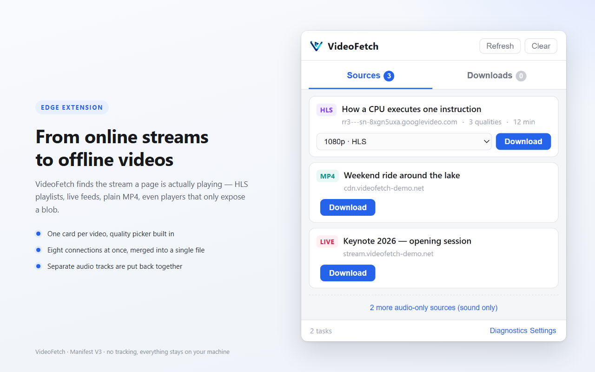
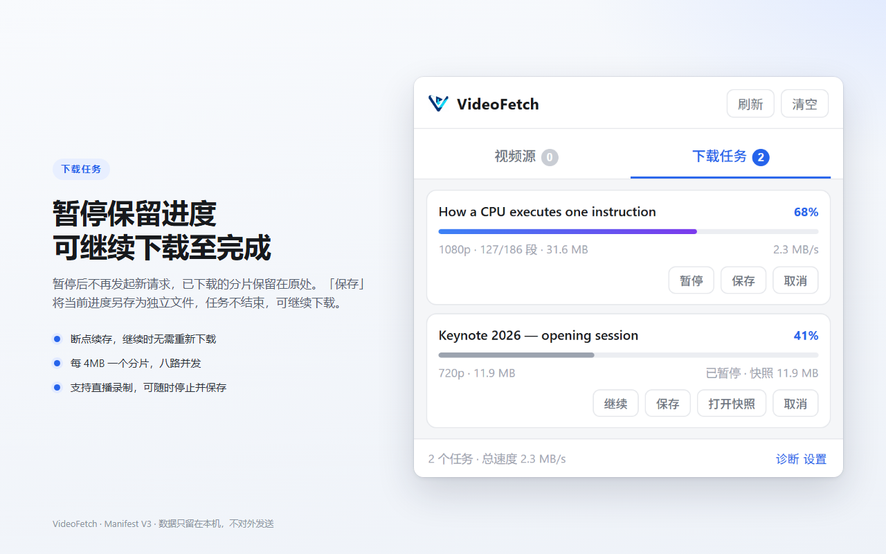

# VideoFetch

[English](README.md) · [简体中文](README.zh-CN.md)

**Downloads what a page is playing**: HLS playlists, live streams with no natural end, plain MP4 files, and media that reaches the player only as a `blob:` URL. Segments are assembled locally, in playback order, into one file that plays as it is. Nothing has to be joined afterwards.

This is an Edge / Chrome extension built on Manifest V3. Segments are fetched eight at a time, and on sites that serve picture and sound as two files the tracks are aligned automatically.

[Edge Add-ons](https://microsoftedge.microsoft.com/addons/detail/gbipmnjkkiecibncnjgmlepchnbfobaf) · [Release notes](CHANGELOG.md) · [Supported sites](SUPPORTED_SITES.md)



---

## Install

**Edge (recommended)**: install from [Microsoft Edge Add-ons](https://microsoftedge.microsoft.com/addons/detail/gbipmnjkkiecibncnjgmlepchnbfobaf). The browser handles installation and updates, and Developer mode is not needed.

> Store builds go through Microsoft review and usually trail this repository, so new features arrive a version later. Install from the zip below when you need the newest build.

**Chrome and other Chromium browsers**: download the latest `VideoFetch-<version>.zip` from [Releases](https://github.com/jfxia/VideoFetch/releases), unzip it, open `edge://extensions/` (Chrome: `chrome://extensions/`), enable **Developer mode** in the top right, choose **Load unpacked** and select the unzipped folder (the root of the archive is the extension itself, with no extra folder inside), then refresh the target page.

> Content scripts run only at page load, so the page has to be refreshed once after installing or reloading the extension. Privileged pages such as `chrome://` and the extension stores do not work.

**To change the source or build it yourself**: see Build below.

## Usage

1. Let the video play for a few seconds. The list fills as the page requests media.
   Once a video is found, the toolbar icon carries a red badge with the number of video sources. Pages without video show none
2. Open the popup from the extension icon. Each video appears as one card, and the qualities of one video sit in a single dropdown with the highest selected by default.
3. Select a quality and choose **Download**
4. Switch to **Downloads** to follow progress. Ordinary tasks offer pause, resume and save. Live tasks offer **Stop & save** only.
5. Files go to `Downloads/VideoFetch/` by default. The location can be changed under **Settings** at the bottom right of the panel.



When the list stays empty, open **Diagnostics**: whether the page hooks were installed, how many requests were inspected, and which media-like URLs were rejected are all recorded there.

## Features

- **Finding the source**: Open the popup once the page has started playing and it lists the videos that page is using. Several places are watched at once, so a site that blocks one of them usually still leaves another route to the address
- **One finished file**: Segments are assembled in playback order while the download runs, and the result is an mp4 that plays as it is, with nothing left to join
- **Keeping the audio track**: On sites that serve picture and sound as two files, both are fetched and aligned onto one timeline, so the result does not come out silent. Live streams are the exception, see Known limits
- **Correcting a wrong label**: Some sites label a plain AAC track as HE-AAC. A decoder follows that label, looks for data the samples never carried, and the sound comes out dull. The label is rewritten to the encoding the samples actually use while the file is written. The audio is not re-encoded
- **Pause and resume**: Pause stops new requests to the server and leaves the segments already fetched in place. Resume continues from that point instead of starting over
- **Saving a snapshot**: When a playable file is needed before the end, Save writes a copy of the current progress, with the percentage in its name. The original task does not end and keeps downloading
- **Recording live**: A stream without an end marker is treated as live. It is written as it arrives and ended by **Stop & save**. A live stream has no natural end, so ending it is left to the user
- **Encryption and hotlink checks**: Sites with encrypted segments download as usual, the key is fetched and decryption happens locally. A CDN that accepts only requests from its own pages receives that page address in the request, and a probe request is sent before the download begins to confirm the server accepts it

## Labels in the list

`HLS` marks an on-demand stream, `LIVE` a stream without an end marker, `BLOB` data recorded from MSE, `DIRECT` a direct link, and `AUDIO` a sound-only source. The download path and the limits for each type are under Known limits.

Purely audio sources (for example Reddit's `CMAF_AUDIO_64.mp4`, the track split out of a video) are collected under "{n} more audio-only sources" at the bottom of the list and do not count towards the video total while collapsed. Expanded, the button reads **Download audio**; downloading one alone saves an `.m4a`, not an mp4.

Tasks whose separate audio track has been merged are marked "with audio". No badge is shown when the track could not be read: a missing `moov`, a live recording or an unfinished merge can all cause that, and not reading one does not mean there is none, so no negative conclusion is drawn.

## Settings

Open **Settings** at the bottom right of the panel, or the extension's options entry in `edge://extensions`.

**Video storage location**

- **Browser download folder** (default): `chrome.downloads` can only write into the browser's download directory and rejects absolute paths, so the settings page takes a subfolder, `VideoFetch` by default. Left empty, files go to the root of the download folder. Multi-level paths such as `Video/Shows` work as well
- **Custom folder**: pick any directory on the settings page. The resulting `FileSystemDirectoryHandle` is stored in IDB under the extension origin, and the offscreen engine writes to it through `createWritable`

The directory picker needs a user gesture, and the popup closes as soon as it loses focus, so the picker is offered on the settings page only. When the permission lapses, downloads fall back to the browser download folder and the task card states where the file was actually saved. Nothing switches silently.

**Interface language**

The interface follows the browser: English by default, Chinese when the browser language is `zh-*`. Either can be locked in settings, and a change takes effect immediately. Chinese errors thrown by the engine are translated in the English interface, and errors outside the table keep their original text.

**Duplicate names**

A number is appended automatically. Existing files are never replaced.

---

## Technical details

The sections below are for development and contribution. Ordinary users can skip them.

### The four sniffing channels

| Channel | Covers | Limits |
|---|---|---|
| `webRequest` response headers | Most playback requests, independent of how the page is built | Requests sent through the page's service worker carry no `tabId`; attribution falls back to `initiator` |
| Page hooks on `fetch` / `XHR` | Playlist requests made by the player itself, where the content-type can be read | Not hookable when the request happens inside a worker |
| JSON bodies of API responses | Sites that hand the playlist to the player before playback, such as `video_info.variants` in X's tweet API | Only responses with a JSON content-type and an API-like URL, 4 MB each |
| Resource Timing | Requests missed by the three above, added by URL pattern | URL only, no response headers |

The same m3u8 often appears more than once; the list deduplicates by URL. Which channel found a source does not affect the download.

### Repository layout

Source sits at the repository root, and **`dist/` is the only loadable build** (`_dev/` and `_shots/` are not packaged).

```text
dist/                            build output, load the extension from this level
├── manifest.json
├── _locales/{en,zh_CN}          extension name and description (follows the browser language, en by default)
├── background/service-worker.js sniffing hub + list state + offscreen scheduling + message routing
├── content/inject.js            MAIN world: hooks fetch/XHR/createObjectURL/MediaSource
├── content/content.js           ISOLATED: forwards events, carries recorded bytes back to the extension
├── offscreen/engine.js          download engine: concurrency, live polling, decryption, remuxing, writing, saving
├── lib/m3u8.js                  playlist parsing
├── lib/remux.js                 TS to fMP4 assembler (with fallbacks)
├── lib/mp4time.js               timeline reset + moov duration patching
├── lib/crypto.js                AES-128-CBC decryption
├── lib/store.js                 segment staging (OPFS first, memory fallback)
├── lib/settings.js              storage location and language settings
├── lib/fsdir.js                 custom folder handle: IDB storage, permissions, writing
├── lib/i18n.js                  both language tables + DOM filling + engine error translation
├── popup/*                      list / quality / task progress
├── settings/*                   settings page
└── vendor/mux.min.js            MPEG-TS remuxing (Apache-2.0)
```

The download runs in an offscreen document. An MV3 service worker is recycled after about thirty seconds of inactivity and has no DOM or Blob, so it cannot create the Blob URL that `chrome.downloads` requires.

Timestamps keep their original values for the length of the download and are shifted once assembly is done. `setBaseMediaDecodeTime` in mux.js 6.3 has no effect on this path (the segment timelines overlap in practice), so the original PTS is carried through to keep continuity, and `lib/mp4time.js` moves `tfdt` back to zero after the segments are assembled.

Blob sources are captured at `SourceBuffer`. Whatever the player looks like, media data passes through `appendBuffer`, which makes this the one entry point that does not depend on site internals.

### Build

```bash
python _dev/build.py
```

Clears and rebuilds `dist/`, checks that every path referenced by `manifest.json` exists, and packs `VideoFetch-<version>.zip`.

### Tests

No test framework is used. Each suite is a Node script with its own assertions. `_dev/serve.mjs` serves fixtures with `Range` support, and `?delay=` or `?rate=` reproduces a slow link when the timing of pause and resume has to be checked.

```bash
node _dev/serve.mjs 8898        # fixtures at http://127.0.0.1:8898/player.html

node _dev/test-e2e.mjs          #  38  parsing / remuxing / decryption
node _dev/test-engine.mjs       #  62  full engine runs against a mocked chrome API
node _dev/test-merge.mjs        #  41  fMP4 audio merging
node _dev/test-popup.mjs        #  95  source list, quality picker, task buttons, English UI
node _dev/test-settings.mjs     #  82  subfolder normalisation, settings, i18n, custom folder writing
node _dev/test-sniff.mjs        #  34  background sniffing, attribution and the badge
node _dev/test-inject.mjs       #  32  page hooks in a VM sandbox
node _dev/test-referer.mjs      #  23  referer decisions against a fake fetch
node _dev/test-pause.mjs        #  82  pause / resume / snapshot saving on slow fixtures
node _dev/test-store.mjs        #  25  staging and cleanup against an in-memory OPFS
```

514 assertions in total. The number on the right of each suite is its assertion count. The fixtures are real media generated with ffmpeg, plus one CMAF set taken from a live HLS feed to cover the split-audio path.

## Known limits

- **No DRM support**: Widevine, FairPlay and `SAMPLE-AES` streams return an error
- **HEVC and AC3 in TS**: these are saved as `.ts`, because mux.js handles only H.264 with AAC / MP3
- **Blob recording captures what has played** and cannot be paused. The data goes to the browser's private disk area for the site, so size is no longer capped in practice (browser disk quota applies). Environments without that area fall back to memory with an about 400 MB cap
- **A live stream needs a manual stop**: recording runs until **Stop & save** is pressed. Pausing a live task loses whatever was not captured
- **Separate audio tracks are not merged for live**: the result may be silent
- **Pause state lives in the background context**: the cursor is held in the offscreen document's memory and OPFS. Reloading the extension discards it, and the task has to start over
- **Discovery requires a page load**: refresh the tab after installing or reloading the extension
- **The custom folder is picked once in settings**: the picker needs a user gesture and the popup closes on blur. When the permission lapses, downloads fall back to the browser download folder and the task states the actual location
- **Saving produces a snapshot**: every save copies the progress so far and occupies temporary space in OPFS. The task itself does not end. The copy is deleted three minutes after it is written. Staging segments go when the task ends (done, canceled or failed); a paused task keeps them so it can resume
- **Ranged resume depends on the server**: a server that ignores `Range` means the download restarts from zero. An MP4 with `moov` at the end cannot play after truncation; the container format decides that
- **One-time signed segments expire**: some sites sign segment URLs, and resuming after a long pause fails

## Licence

MIT, see [LICENSE](LICENSE). The bundled `vendor/mux.min.js` is Apache-2.0, © Video.js contributors.
