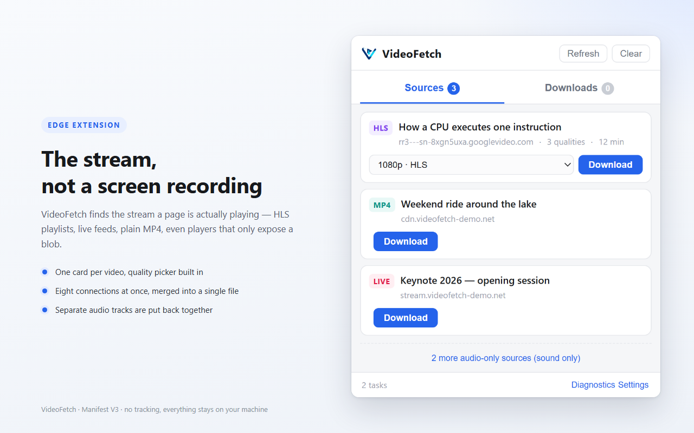

# VideoFetch

English · [简体中文](README.zh-CN.md)

A Manifest V3 extension for Edge and Chrome that downloads the video a page is playing: HLS playlists, live streams, plain MP4, and players that only expose a `blob:` URL.



## What it does

- **Finds the stream.** Four channels feed the list, so a site that hides its player from one of them usually shows up in another: response headers via `webRequest`, page-level `fetch`/`XHR` hooks, JSON API response bodies that carry a video manifest, and Resource Timing as a last resort.
- **Downloads in parallel.** HLS segments are fetched eight at a time and delivered in order. TS segments are remuxed to fMP4 with mux.js; fMP4 segments are concatenated directly. Plain files fall back to 4 MB ranged chunks.
- **Keeps the audio.** HLS audio renditions (`EXT-X-MEDIA`) are downloaded and merged back. When a site serves video and audio as two separate files, VideoFetch fetches the paired HLS playlist to get the sound. MSE players that push two `SourceBuffer`s get both recorded and joined.
- **Pause and resume.** Pause takes effect immediately — in-flight requests are aborted after 400 ms and the segment cursor stays put. Resume continues from that cursor. "Save" writes the current progress to a second file (`clip (40%).mp4`) and leaves the task running.
- **Records live streams.** A playlist without `#EXT-X-ENDLIST` is treated as live and polled at its target duration. You stop it when you want; the file is finished then.
- **Handles the annoying parts.** AES-128 segment keys, `EXT-X-BYTERANGE`, servers that ignore `Range`, and CDNs that reject a request without the right `Referer` (a session DNR rule, verified with a one-byte probe before the download starts).
- **Saves where you want.** The browser download folder with an optional subfolder, or any folder you pick once on the settings page. Files with the same name get a `(2)` suffix instead of being overwritten.
- **Speaks two languages.** English by default; Chinese when the browser is Chinese. Switchable in settings.


## Install

### Load the unpacked build

1. Run `python _dev/build.py` (or use a release zip, unpacked)
2. Open `edge://extensions/` (Chrome: `chrome://extensions/`)
3. Turn on **Developer mode**
4. **Load unpacked** → pick `dist/`
5. Refresh the page you want to download from — content scripts only run at page load

### Store

The listing is prepared but not published yet. When it is, this section will carry the link.

## Using it

1. Play the video for a second or two. The list fills as the page requests media.
2. Click the toolbar icon. Each video gets one card; multiple qualities of the same video collapse into one dropdown, highest first.
3. Pick a quality and hit **Download**.
4. Switch to **Downloads** for progress. Every task has pause/resume and save. Live tasks only have **Stop and save**.
5. Files go to `Downloads/VideoFetch/` unless you change it in **Settings** (bottom right).

The **Diagnostics** panel shows whether the page hooks are installed, how many requests were inspected, and which media-looking URLs were rejected — useful when a site shows nothing.

## Build

```bash
python _dev/build.py
```

Copies the source into `dist/`, checks that every path referenced by `manifest.json` exists, and packs `VideoFetch-<version>.zip`. `_dev/` and `_shots/` are not included.

## Tests

No test framework; each suite is a Node script with its own assertions. `_dev/serve.mjs` serves the fixtures with `Range` support and an optional `?delay=` / `?rate=` so timing behaviour can be reproduced.

```bash
node _dev/serve.mjs 8898        # fixtures at http://127.0.0.1:8898/player.html

node _dev/test-e2e.mjs          #  38  playlist parsing, remuxing, decryption
node _dev/test-engine.mjs       #  62  full engine runs against a mocked chrome API
node _dev/test-merge.mjs        #  21  fMP4 audio merging
node _dev/test-popup.mjs        #  71  source list, quality picker, task buttons, English UI
node _dev/test-settings.mjs     #  82  subfolder normalisation, settings, i18n, folder writing
node _dev/test-sniff.mjs        #  11  background sniffing and attribution
node _dev/test-inject.mjs       #   8  page hooks in a VM sandbox
node _dev/test-referer.mjs      #  23  referer decisions against a fake fetch
node _dev/test-pause.mjs        #  82  pause, resume, snapshot saving on slow fixtures
```

398 checks in total. Fixtures are real media generated with ffmpeg, plus one CMAF set pulled from a live HLS feed to lock down the split-audio path.

## How it works

| Piece | Role |
|---|---|
| `background/service-worker.js` | Sniffs requests, owns the per-tab list and the task table, routes messages, drives the offscreen document |
| `content/inject.js` | MAIN world. Hooks `fetch`, `XHR`, `createObjectURL` and `MediaSource` |
| `content/content.js` | ISOLATED world. Forwards events, carries recorded bytes back to the extension |
| `offscreen/engine.js` | The download engine: concurrency, live polling, decryption, remuxing, writing files |
| `lib/m3u8.js`, `lib/remux.js`, `lib/mp4time.js` | Playlist parsing, TS→fMP4 assembly, timestamp normalisation and `moov` duration patching |
| `lib/store.js` | Segment staging, OPFS first with an in-memory fallback |
| `lib/settings.js`, `lib/fsdir.js`, `lib/i18n.js` | Save location, folder handles, both language tables |

Three decisions worth knowing:

- **Downloads run in an offscreen document.** A service worker gets recycled and has no DOM, so it cannot create a Blob URL for `chrome.downloads`.
- **Timestamps are kept, then shifted.** mux.js 6.3's `setBaseMediaDecodeTime` does not take effect on this path (segments overlap), so the remuxer keeps the original PTS and `lib/mp4time.js` shifts `tfdt` afterwards.
- **Blob sources are recorded through `SourceBuffer`.** Whatever the player does, media data eventually passes through `appendBuffer`. That is the one hook that does not depend on site internals.

## Known limits

- **No DRM.** Widevine, FairPlay and `SAMPLE-AES` streams report an error.
- **HEVC / AC3 in TS** are saved as `.ts` — mux.js only handles H.264 with AAC or MP3.
- **Blob recording only captures what has played**, up to roughly 400 MB, and cannot be paused.
- **Live streams must be stopped by hand**, and a paused live stream loses the missed part.
- **Live audio renditions are not merged** yet; a live recording can end up silent.
- **Pause state lives in the background page.** Reloading the extension loses the bookmark and the task has to restart.
- **Sniffing needs a page load.** Install or reload the extension, then refresh the tab. Privileged pages (`chrome://`, extension stores) never work.
- **Custom folders need one gesture.** The folder picker only opens from the settings page; when permission lapses, downloads fall back to the browser folder and the task card says so.
- **Saving is a snapshot, not a finish.** Each save copies the current file (temporary space in OPFS, removed when the download completes).
- **Ranged resume depends on the server.** Files that ignore `Range` restart from zero; an MP4 with `moov` at the end cannot play after being truncated.

## Store assets

`store/` holds the Edge Add-ons material: icon, screenshots, promotional tiles, listing copy in both languages and the privacy policy. `python _dev/make-store-art.py` regenerates the images — they are rendered from the real popup and settings pages with fixed data, not drawn by hand.

## Licence

MIT, see [LICENSE](LICENSE). The bundled `vendor/mux.min.js` is Apache-2.0, © Video.js contributors.
